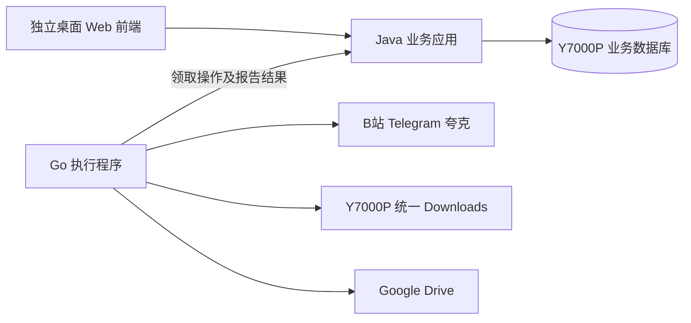

# AllDownloads v2

本项目面向一位用户，在 Y7000P 本机通过桌面浏览器管理 Bilibili、Telegram 和夸克内容。开发资料与源码根目录为 `D:\Code\Other\AllDownloads-v2`。本机 Carbon 仅承担开发、构建与隔离测试；最终部署、正式运行和真实验收均在 Y7000P。这里的源码目录是 Carbon 的工作目录，不代表 Y7000P 的部署位置。

2026 年 10 月 15 日需求基线：全新构建，前后端分离，不迁移、兼容、扫描或清理旧版数据。B 站的信息、下载、存档分别管理，下载由用户主动发起。夸克先转存并持续更新网盘，用户另行选择网盘文件下载。所有下载进入一个统一的本机根目录。

## 主机分工

| 主机 | 职责 | 保存内容 |
| --- | --- | --- |
| Carbon 本机 | 编辑代码与文档、安装项目依赖、编译打包、运行 mock 和隔离测试 | 源码、构建产物、可重建测试数据 |
| Y7000P | 最终部署，运行前端发布产物、Java 和 Go，连接真实账号，执行下载、上传和持续运行验收 | 正式配置、账号会话、业务数据库、任务记录、媒体及下载缓存 |

产品文档中的“本机下载”“本机数据库”“打开本机目录”均指 Y7000P；开发语境中的“本机”指 Carbon。开发用进程只用于测试，不作为正式后台。发布包不得携带 Carbon 的绝对路径、账号会话、测试数据库或下载文件；Y7000P 部署路径与运行配置在部署时明确。

## 仓库与协作

代码与正式资料统一保存到 [moonseries667/AllDownloads-v2](https://github.com/moonseries667/AllDownloads-v2)，远端地址为 `git@github.com:moonseries667/AllDownloads-v2.git`。前端、Java、Go 使用同一仓库，以共同契约协调；独立对话默认使用各自工作树和短期任务分支，协调者组织 PR 集成。开发前先读 [Git 与项目协作指南](docs/GIT-PROJECT-GUIDE.md)。

## 阅读顺序

| 文件 | 用途 |
| --- | --- |
| [产品规则](docs/PRODUCT.md) | 用户行为、平台范围、目录及明确默认值；所有对话共同遵守 |
| [后端需求](docs/BACKEND.md) | Java 与 Go 的职责、持久化、恢复、账号与外部工具要求 |
| [前端需求](docs/FRONTEND.md) | 页面结构、交互、状态展示和独立开发方式 |
| [前端接口契约](contracts/HTTP-API.md) | Java 面向浏览器的资源、字段、动作与错误语义 |
| [执行协议](contracts/RUNNER.md) | Java 与 Go 的操作协议、结果确认与任务恢复 |
| [验收标准](docs/ACCEPTANCE.md) | 真实业务流程及故障注入验收 |
| [Git 与项目协作指南](docs/GIT-PROJECT-GUIDE.md) | 分支与工作树、任务管理、契约变更、PR、检查及发布交接 |
| [并行开发安排](docs/PARALLEL.md) | 各对话的文件归属、开工提示及集成顺序 |
| [项目工作约定](AGENTS.md) | 防止多个对话改动冲突和需求漂移 |

## 架构决策

前端独立构建；Java 提供唯一公共业务接口，管理所有业务状态和持久任务；Go 作为统一执行程序，负责平台访问、下载、文件处理、上传与核对。三个平台不各建一套后端。

只需要两个自有后端常驻程序。首版不引入消息中间件、服务注册中心或每平台一套数据库。Java 负责决定“做什么、何时做、算不算成功”，Go 负责执行并报告可核对的事实。

稳定性通过持久任务、唯一写入职责、幂等、失败阶段隔离和恢复测试获得，不能由“换成 Go/Java”直接推定。文档是开发基线，尚不是已经通过实测的软件。

## 建设与验收状态

需求及协议是建设基线，不表示功能已实现。具体实现、检查、联调与远程验收状态以对应任务和 PR 为准；各模块建立后在自己的 README 提供构建和测试命令。当前治理基线提供协作指南和 Issue/PR 模板，尚未配置自动 CI、GitHub 看板或分支保护规则。

文档中的自动转存、下载、上传描述新产品功能，不能作为当前开发对话操作真实账号或部署的授权。推送源码不代表已经在 Y7000P 上运行。
